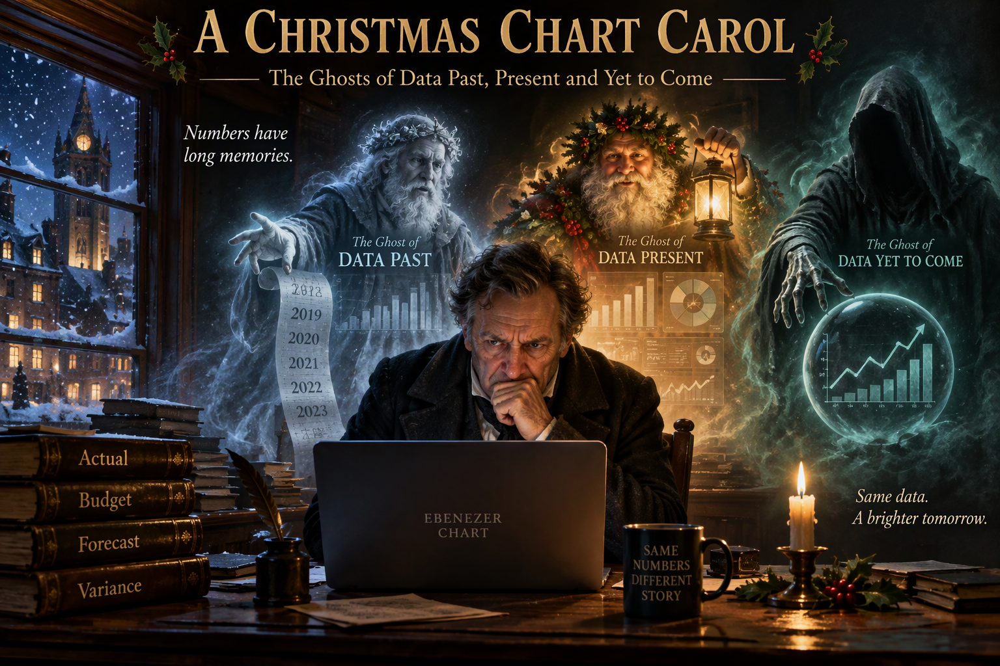

# chart_tales
### *A Christmas Chart Carol — 24 Lessons in Charts & Storytelling with Data through Charles Dickens*

**Author:** Frank Ellingsen | *Tales with Charts*  
**Portfolio:** [frank-ellingsen.github.io](https://frank-ellingsen.github.io/datafrank.github.io/)  
**Visual Pedagogy:** Edward Tufte Data-Ink Ratio & The Financial Times Visual Vocabulary  

---

<p align="center">
  
</p>

<p align="center">
  <a href="https://frank-ellingsen.github.io/chart_tales/a_christmas_chart_carol_report.pdf">
    
  </a>
  <br>
  <strong><a href="https://frank-ellingsen.github.io/chart_tales/a_christmas_chart_carol_report.pdf">📄 Download 28-Page PDF Report</a></strong> &bull; 
  <strong><a href="https://frank-ellingsen.github.io/chart_tales/">🌐 Interactive Web Portal</a></strong>
</p>

---

## 📖 Overview

**chart_tales** is a 24-day LinkedIn Advent Masterclass connecting the principles of modern data visualization, information design, and analytical storytelling with the life, books, screen adaptations, theater triumphs, eccentric habits, and lore of **Charles Dickens (1812–1870)**.

Inspired by Dickens' classic *A Christmas Carol*, the repository is structured around four dramatic narrative acts:
1. **Act I — Opening the Windows (Days 1–6):** Foundational chart selection, baseline integrity, and cognitive clarity.
2. **Act II — The Ghost of Data Past (Days 7–12):** Historical baselines, before-vs-after transformations, and relative velocity.
3. **Act III — The Ghost of Data Present (Days 13–18):** True distributions, outlier investigation, bivariate correlation, and step-by-step causal bridges.
4. **Act IV — The Ghost of Data Yet to Come (Days 19–23):** Demarcating fact from projection, embracing uncertainty with fan bands, scenario branches, and volume flow.
5. **Christmas Eve Grand Finale (Day 24):** *Charles Dickens: A Life in Data (1812–1870)* — The storyteller becomes the story.

---

## 🎨 The 4 Storytelling Design Pillars

Every post and visual in this series demonstrates an actionable, practical lesson in executive data communication:

1. **Action Headlines vs. Generic Topic Titles:**  
   * ❌ *Generic Topic:* "Word Counts of Dickens' Novels"  
   * ✅ *Action Headline:* **"David Copperfield Reigns Supreme at 360,000 Words—More Than Triple Hard Times"**  
   *(State the conclusion directly in the headline; never force the reader to decode the insight).*
2. **Direct Labeling over Floating Legends:**  
   Eradicate separate color legends that force the reader's eyes to bounce back and forth. Label lines, bars, and markers directly at their point of impact.
3. **Strategic Annotations & Pointer Callouts:**  
   Use callout text and arrows to spotlight historical turning points and narrative inflection anomalies (e.g. the 1843 *A Christmas Carol* publication, or the 1865 Staplehurst rail disaster).
4. **Edward Tufte's Data-Ink Ratio:**  
   Eliminate vertical gridlines, decorative 3D bevels, and rainbow palettes. Keep baseline data in muted tones and reserve high-contrast color exclusively for the hero insight.

---

## 📂 Repository Structure

```
chart_tales/
├── README.md                           # Project documentation & curriculum guide
├── linkedin_posts_25_series.md         # All 25 complete, ready-to-publish LinkedIn posts
├── a_christmas_chart_carol_report.pdf  # 28-page executive publication-ready PDF report
├── a_christmas_chart_carol_report.html # Self-contained HTML report
├── generate_pdf_report.py              # Automated Python PDF generator (Edge headless)
├── img24/                              # 25 high-resolution Victorian & modern visual cards
│   ├── image00.png                     # Series Cover Poster
│   ├── img0.png                        # Prologue Visual Card
│   ├── image1.png                      # Day 1: Bar Chart
│   └── ...                             # Days 2 to 24 (image2.png to image24.png)
└── data/
    └── dickens/                        # Structured Dickensian CSV datasets
        ├── dickens_novels.csv          # 18 works, word counts, characters, publication format
        ├── dickens_adaptations.csv     # Film, theater, and TV screen adaptations & ratings
        └── dickens_biography.csv       # Career milestones, earnings, and reading tour data
```

---

## 📊 25-Day Visual Index

| Day | Chart Type | Dickens Theme & Real Data | Data Storytelling Lesson |
| :---: | :--- | :--- | :--- |
| **0** | **Series Poster** | 35-year literary career & 4.5M words | **The Narrative Arc:** Protagonist, conflict, and resolution |
| **1** | **Horizontal Bar Chart** | Novel word counts: *Copperfield* (360k) vs *Hard Times* (105k) | **Action Headlines & Horizontal Orientation** |
| **2** | **Column Chart** | Chronology of 15 novels (1836–1870) | **Zero-Baseline Integrity:** Never truncate column baselines |
| **3** | **Dot Plot** | Character census: *Pickwick* (260) vs *Hard Times* (44) | **Data-Ink Ratio:** Minimal dots replace heavy bars |
| **4** | **Lollipop Chart** | Adaptations: *Carol* (135+) vs *Barnaby Rudge* (6) | **Point-of-Impact Labeling:** Values directly beside nodes |
| **5** | **Line Chart** | Cumulative output: 300k words (1836) $\rightarrow$ 4.5M words (1870) | **Direct Line End-Labels:** Kill the floating legend box |
| **6** | **Area Chart** | Readership volume: *Household Words* reaching 100k weekly | **Volume & Opacity:** 30–40% transparency preserves gridlines |
| **7** | **Slope Chart** | The 1858 shift: Solo reading tours rose to 72% of earnings | **Vector Deltas:** Connect benchmark years directly |
| **8** | **Dumbbell Chart** | The serialization quota: 32 planned pages vs actual printed | **Focus on the Span:** Barbell length measures variance |
| **9** | **Indexed Line Chart** | Fame velocity (Base 100 in 1840): Dickens vs Thackeray vs Trollope | **Base-100 Normalization:** Compare relative growth velocity |
| **10** | **Small Multiples** | Chapter pacing across 4 masterworks on synchronized axes | **Shared Scale Discipline:** Micro-panels enable instant scanning |
| **11** | **Calendar Heatmap** | The Night Walker: Mapping Dickens' 15–20 mile nightly walks | **Single-Hue Density:** Sequential ramps prevent rainbow noise |
| **12** | **Bump Chart** | 150-year popularity shifts: The rise of *Bleak House* | **Accent the Changers:** Highlight climbers; mute static ranks |
| **13** | **Histogram** | Chapter length distributions: The 3,800-word reading mode | **The Fallacy of the Mean:** Binned spreads expose human habits |
| **14** | **Box Plot** | Pacing spread by era: Early picaresque vs late taut suspense | **Outlier Dots as Stories:** Annotate anomalies as plot twists |
| **15** | **Scatter Plot** | Novel length vs adaptations ($r = -0.42$ negative correlation) | **Reference Quadrants:** 4 narrative zones with median crosshairs |
| **16** | **Bubble Chart** | 3D Map: Word Count (X), Characters (Y), Adaptations (Size) | **Area Scaling Law:** Scale by area ($\pi r^2$), never diameter |
| **17** | **Treemap** | Lifetime canon: Novels (68%), Journalism (18%), Plays (4%) | **Rectangles over Pie Slices:** Clean hierarchical part-to-whole |
| **18** | **Waterfall Chart** | 1843 *A Christmas Carol* economics: £1,050 gross $\rightarrow$ £137 net | **The Causal Bridge:** Step-by-step inflows and deductions |
| **19** | **Forecast Chart** | What if he finished *The Mystery of Edwin Drood*? | **Demarcating Fact from Forecast:** Solid history vs dashed future |
| **20** | **Fan Chart** | Modeling £50k–£250k lost to 19th-century American piracy | **Embrace the Fan:** P10/P50/P90 probability bands |
| **21** | **Scenario Chart** | 3 Publishing Models: Flat Fee vs Serial Parts vs Owned Platform | **Actionable Triggers:** Tie every scenario line to a decision lever |
| **22** | **Sankey Diagram** | 15 Novels $\rightarrow$ 300+ Modern Media (Films, TV, Stage Plays) | **Ribbon Proportions:** Tracing categorical migration across time |
| **23** | **Connected Scatter** | Creative Output vs Physical Vitality (1835–1870) | **Directional Loops:** Connecting points chronologically |
| **24** | **Grand Finale** | *Charles Dickens: A Life in Data (1812–1870)* | **The Grand Moral:** Numbers have long memories; stories give them soul |

---

## 🛠️ Usage & Compilation

To re-compile the 28-page PDF report with Microsoft Edge headless:
```bash
python generate_pdf_report.py
```

---

## 📜 License & Acknowledgements

Created by **Frank Ellingsen** (*Tales with Charts*).  
Inspired by the storytelling genius of **Charles Dickens**, the data visualization principles of **Edward R. Tufte**, and the **Financial Times Visual Vocabulary**.
